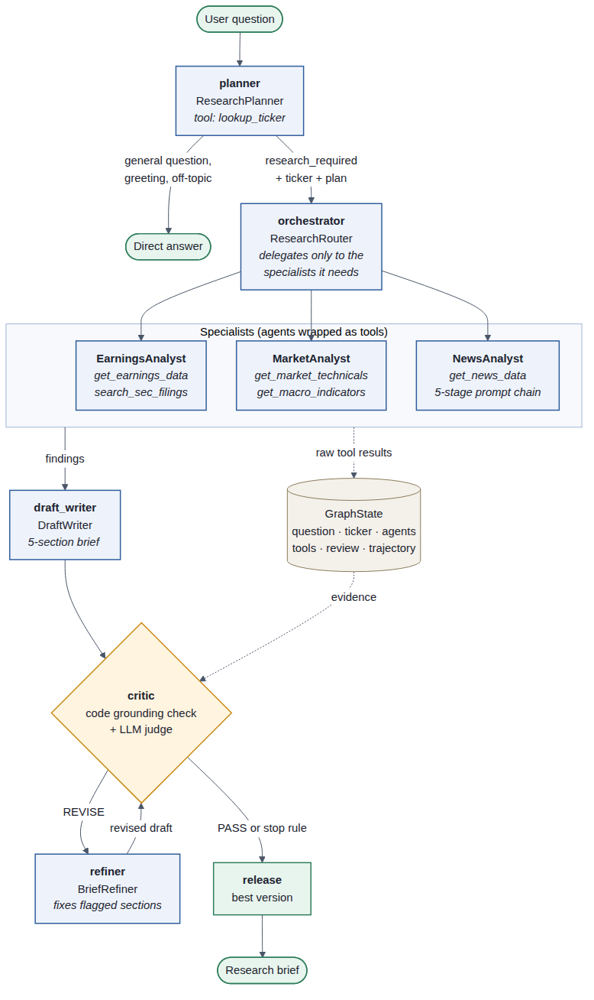
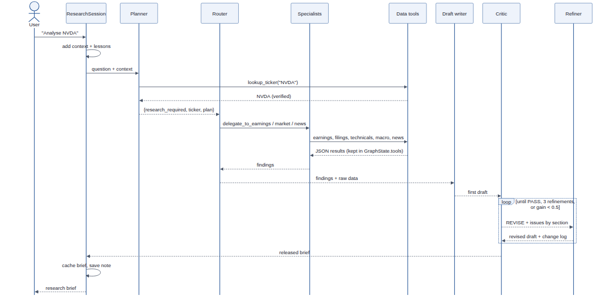
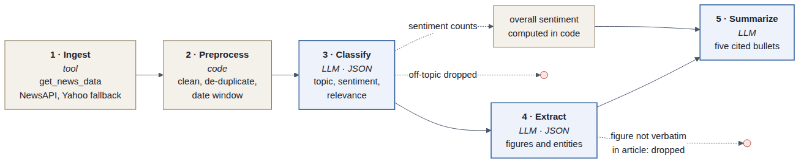
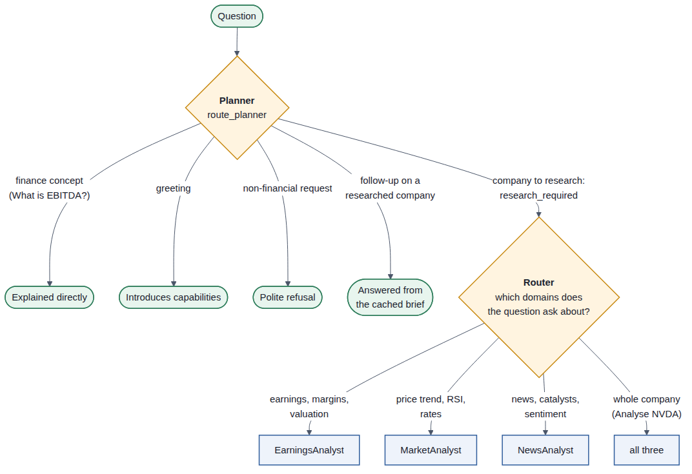
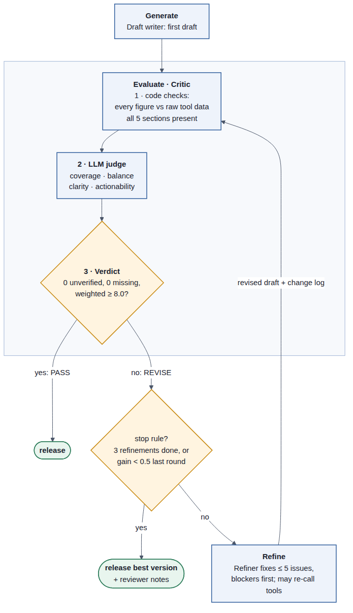
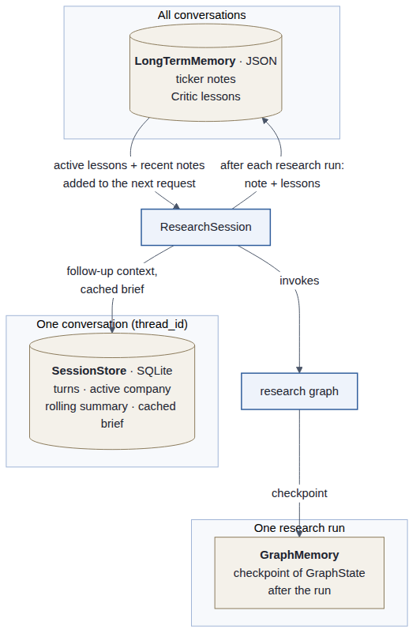
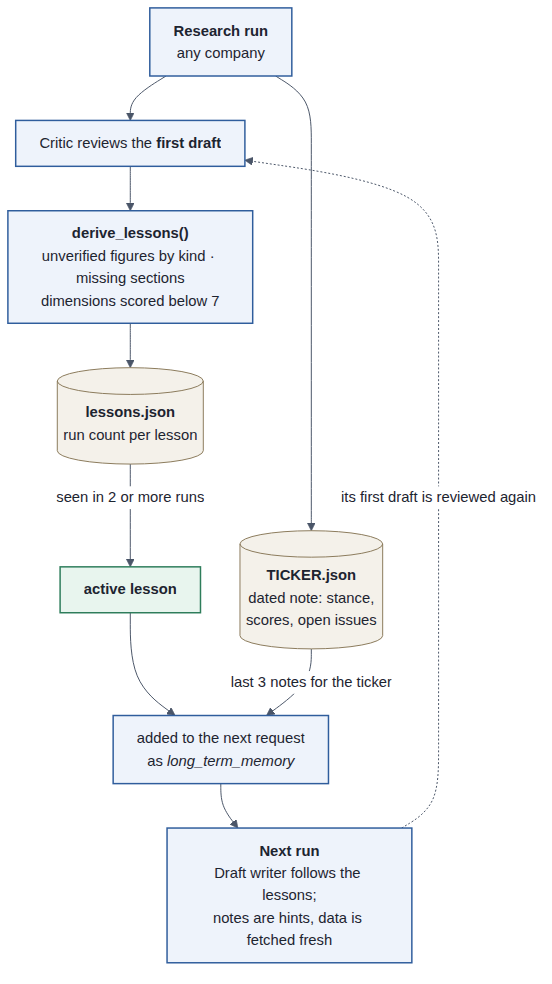

# Investment Research Agent

https://github.com/user-attachments/assets/01b3ecf5-5327-4ca6-95ef-e74cf1d1d5f1

*Two-minute demo: the three specialist agents, the workflow patterns, the Critic's fact check and a live NVDA run in the Gradio app.*

A multi-agent LLM system that researches a US-listed stock. You ask a question in plain English
("Analyse NVDA"). The system plans its research, fetches live data with tools, writes a
five-section research brief, checks every figure in it against the raw data, fixes what fails,
and releases the brief. You can then ask follow-up questions in the same conversation, and the
system keeps notes and lessons that improve later runs.

Built for **AAI-520 Natural Language Processing and GenAI** (University of San Diego, MS Applied AI).

[](https://colab.research.google.com/github/diaeshantony-usd/investment-research-agent/blob/main/notebooks/investment_research_agent.ipynb)

📄 **Design document:** [Multi-Agent Investment Research System — Design Doc](https://docs.google.com/document/d/1PjKU47bT6VsPgoFgJWckJpvaSPAeqeclrmysAvf-fb8/edit?usp=sharing)

---

## Contents

1. [Quick start](#quick-start)
2. [Installation](#installation)
3. [How to run it](#how-to-run-it)
4. [Example questions](#example-questions)
5. [How it works](#how-it-works)
6. [Agents](#agents)
7. [Workflow patterns](#workflow-patterns)
8. [Critic and Refiner loop](#critic-and-refiner-loop)
9. [Memory](#memory)
10. [Data sources and tools](#data-sources-and-tools)
11. [Configuration](#configuration)
12. [Repository structure](#repository-structure)
13. [Tests and code quality](#tests-and-code-quality)
14. [Team](#team)
15. [Design decisions](#design-decisions)

---

## Quick start

The fastest way to see everything is the project notebook in Google Colab. Nothing to install:

1. Open the notebook in Colab with the **Open in Colab** badge above.
2. Choose **Runtime → Run all**.
3. Click **Run anyway** when Colab warns that the notebook comes from GitHub.

The first cell clones this repository and installs it. A full run takes about 10–15 minutes,
because it calls the LLM and the market-data APIs live. The notebook explains the design and
demonstrates every graded requirement (planning, tool use, self-reflection, learning across runs,
prompt chaining, routing and the evaluator-optimizer loop).

---

## Installation

Requirements: **Python 3.11 or newer** and internet access (the LLM and the data APIs are online).

```bash
git clone https://github.com/diaeshantony-usd/investment-research-agent.git
cd investment-research-agent

python -m venv .venv
source .venv/bin/activate          # Windows: .venv\Scripts\activate

pip install -e .                   # core package and the research-agent command
pip install -e ".[ui]"             # optional: adds the Gradio chat UI
pip install -e ".[dev]"            # optional: tests, ruff, mypy (includes Gradio)
```

**API keys: no setup needed.** The project runs straight after `pip install -e .`. Working
default keys for Ollama Cloud (the LLM), NewsAPI, FRED and Alpha Vantage are set in
`src/research_agent/config.py`, and SEC EDGAR and Yahoo Finance need no key. To use your own keys
or another model, copy the template and edit it; values in `.env` override the defaults (see
[Configuration](#configuration)):

```bash
cp .env.example .env
```

---

## How to run it

There are four ways to use the system. All of them go through the same `ResearchSession`, so
follow-up questions, caching and long-term memory behave the same everywhere.

### 1. Command line: one question

```bash
research-agent "Analyse NVIDIA (NVDA)"
# or, without installing the console script:
python cli.py "Analyse NVIDIA (NVDA)"
```

While it runs, each line shows the agent at work (`Agent: [...]`) or a tool call with its
arguments (`Tool: [...]`). The released brief is printed at the end.

### 2. Command line: a conversation (`--interactive`)

```bash
python cli.py --interactive              # or: research-agent --interactive
```

The session starts and prints its thread id, then waits at the `Query >` prompt:

```text
=== Research Session Started [thread_id: session_20261015_100031_9907] ===
Type 'exit' or 'quit' to end session.

Query > Analyse Apple (AAPL)
  Agent: [ResearchPlanner] Analyzing query intent and resolving company ticker symbol...
  Tool: [ResearchPlanner] lookup_ticker(company_name='Apple', query='Apple')
  Tool: [ResearchRouter] delegate_to_earningsanalyst(...)
  Tool: [EarningsAnalyst] get_earnings_data(ticker='AAPL')
  ...
=== RELEASED BRIEF ===
...
Query > What about its margins?
=== RELEASED BRIEF ===
Apple's most recent quarter showed: gross margin ..., operating margin ..., net margin ...
Query > exit
```

- A full research question takes about 3 minutes; a follow-up about the same company is answered
  from the cached brief in a few seconds, without naming the company again.
- Type `memory` to print what the session remembers (active company, tickers, conversation).
- Type `exit`, `quit` or `q` (or press Ctrl+D) to leave.
- Conversations are saved. Reopen one with its thread id:
  `python cli.py --interactive --thread-id session_20261015_100031_9907` (short form: `-i -t <id>`).

### 3. Gradio chat UI

```bash
pip install -e ".[ui]"     # Gradio is an optional extra
python gradio_app.py       # or: research-agent-ui
```

Open <http://127.0.0.1:7860> in your browser and type a question in the chat box, or click one of
the suggestion chips ("Analyse NVDA", "Analyse AAPL", "What is operating margin?"). A
"Researching…" status shows while the agents work; the reply is the brief, with the agent steps
in a collapsible "Reasoning · N steps" panel above it.

- Ask follow-ups in the same chat; the chips switch to follow-ups for the active company.
- **New research** starts a fresh conversation. The left rail lists earlier conversations; click
  one to reopen it, or open **Resume by thread id**, enter an id and click **Start / Resume**.
- **Export report** downloads the conversation as a Markdown report.
- Each browser tab is its own conversation. Stop the server with Ctrl+C in the terminal.

### 4. Python or a notebook

```python
from research_agent.memory import ResearchSession

session = ResearchSession(thread_id="nvda-01")

# In a notebook, ask() renders the answer and the agent trajectory as Markdown.
session.ask("Analyse NVDA")

# In a script, use show=False to get the answer back as text.
brief = session.ask("Analyse NVDA", show=False)
answer = session.ask("What about its margins?", show=False)   # follow-up, same company

print(session.active_ticker)   # NVDA
print(session.last_kind)       # how the last turn was classified, e.g. follow_up
```

The project notebook, [`notebooks/investment_research_agent.ipynb`](notebooks/investment_research_agent.ipynb),
walks through the architecture, each agent and every requirement with real runs. The
[`notebooks/demo/`](notebooks/demo) folder has one short notebook per agent.

---

## Example questions

| You ask | What happens |
| --- | --- |
| `Analyse NVDA` | Full research: the router sends the request to all three specialists, then the Draft writer, Critic and Refiner produce the brief |
| `Analyse Apple` · `How is Microsoft doing?` | Company names are resolved to US tickers with Yahoo Finance (AAPL, MSFT) |
| `How are Apple's latest earnings and margins?` | Research routed to the **Earnings** analyst only |
| `What is the price trend and RSI for Tesla?` | Research routed to the **Market** analyst only |
| `Any recent news catalysts for Exxon Mobil?` | Research routed to the **News** analyst only |
| `Compare JPMorgan's fundamentals and news sentiment` | Research routed to the **Earnings** and **News** analysts |
| `What about its margins?` (after a company was researched) | Follow-up: answered from the cached brief, no new research |
| `What are its main risks?` · `Summarise NVDA's latest earnings` | Follow-ups on the active company |
| `What is operating margin?` · `What is EBITDA?` | Finance concept: explained directly, no research |
| `Hi, what can you do?` | Greeting: the assistant introduces what it can do |
| `Analyse NVDAA` | Unknown ticker: "Did you mean NVDA?" instead of researching |
| `What's the weather in Tokyo?` | Off-topic: politely declined; the active company is kept |
| `What was I researching earlier?` | Lists the companies researched in this conversation |

A full research run takes a few minutes. Ask for fresh data (for example "Refresh NVDA with the
latest figures") to re-run the research instead of answering from the cached brief.

---

## How it works



The system is a graph of six nodes built with the team's own small agent framework
(`src/research_agent/agent_framework.py`: `Agent`, `Tool`, `OrchestratorAgent`, `GraphState`,
`StateGraph`, `GraphMemory`). The graph is compiled in `workflows/graph.py`. Nodes share one
`GraphState` object: each node reads what it needs and writes its result back, and raw tool results
stay on the state so the Critic can check the brief against them.

1. **planner** verifies the company with `lookup_ticker` and returns a JSON dispatch with the
   ticker and an ordered research plan, or answers directly when no research is needed.
2. **orchestrator** (the router) delegates to only the specialists the question needs. Each
   specialist is an agent wrapped as a tool, so delegation is an ordinary tool call.
3. **draft_writer** combines the findings into the five-section brief.
4. **critic** reviews the draft; on REVISE, **refiner** fixes the flagged sections and the critic
   reviews again.
5. **release** returns the best version.



| Layer | Contents |
| --- | --- |
| Interfaces | Project notebook, command line (`cli.py`, `research-agent`), Gradio chat UI |
| Session | `ResearchSession`: conversation memory, follow-up resolution, cached briefs, long-term memory |
| Orchestration | `StateGraph` with the planner and review routers; Critic and Refiner loop |
| Agents | Planner, Router, Earnings / Market / News analysts, Draft writer, Refiner |
| Tools | Yahoo Finance, SEC EDGAR, FRED, NewsAPI, Alpha Vantage wrappers with an on-disk cache |
| Storage | API cache, run checkpoints, session database, long-term memory |

---

## Agents

| Agent | File | Tools | Output |
| --- | --- | --- | --- |
| `ResearchPlanner` | `agents/planner.py` | `lookup_ticker`, checkpoint look-up tools | JSON: `research_required`, `ticker`, ordered `plan` |
| `ResearchRouter` | `agents/router.py` | one `delegate_to_<specialist>` tool per specialist | Specialist findings |
| `EarningsAnalyst` | `agents/earnings_analyst.py` | `get_earnings_data`, `search_sec_filings` | Fundamentals, margins, valuation, filing passages |
| `MarketAnalyst` | `agents/market_analyst.py` | `get_market_technicals`, `get_macro_indicators` | Price trend, momentum, macro backdrop |
| `NewsAnalyst` | `agents/news_analyst.py` | `get_news_data` (five-stage chain) | Cited news digest and sentiment |
| `DraftWriter` | `agents/draft_writer.py` | none | Brief: Executive Summary, Fundamentals, Technicals, Catalysts & Risks, Stance |
| `Critic` | `workflows/review_loop.py` | none (code checks + LLM judge) | Scores, issues by section, PASS / REVISE |
| `BriefRefiner` | `agents/refiner.py` | the five data tools | Revised brief and change log |

---

## Workflow patterns

| Pattern | Implementation |
| --- | --- |
| **Prompt chaining** | The News analyst (`workflows/news_chain.py`): ingest → preprocess → classify → extract → summarize |
| **Routing** | `route_planner` decides research vs. a direct answer; the router picks the specialists a question needs |
| **Evaluator–optimizer** | Draft writer generates, Critic evaluates, Refiner improves, until the brief passes or a stop rule applies |



| Stage | Done by | What happens |
| --- | --- | --- |
| 1. Ingest | tool | `get_news_data`: NewsAPI search for the company (Yahoo Finance news as fallback) |
| 2. Preprocess | code | Clean the text, remove duplicates, keep articles inside the date window |
| 3. Classify | LLM (JSON) | Topic, sentiment and relevance per article; off-topic articles are dropped |
| 4. Extract | LLM (JSON) | Key figures and entities; a figure is kept only if it appears verbatim in the article |
| 5. Summarize | LLM | Five cited bullets; the overall sentiment is computed in code |



---

## Critic and Refiner loop



**Critic** (`workflows/review_loop.py`) reviews every draft in three stages:

1. **Code checks (no LLM).** Every figure in the brief must match a number in the raw tool results,
   allowing for its rounding and units (filing tables in thousands or millions, "bn"), or be a
   percentage calculated from figures on the same line. All five sections must be present.
2. **LLM judge.** Scores coverage, balance, clarity and actionability from 0 to 10 and lists issues
   by section. The grounding score comes from the code check, so the model cannot argue its way
   past an invented number.
3. **Verdict.** PASS needs no unverified figures, no missing sections and a weighted score of at
   least 8/10. Otherwise REVISE.

| Dimension | Weight | Scored by |
| --- | --- | --- |
| Grounding | 30% | code (share of verified figures) |
| Coverage | 20% | LLM judge |
| Balance | 20% | LLM judge |
| Clarity | 15% | LLM judge |
| Actionability | 15% | LLM judge |

**Refiner** (`agents/refiner.py`) fixes at most five issues per round, blockers first. It rewrites
only the flagged sections, may call the data tools again to replace an unsupported figure, and
returns a change log.

**Stopping rules.** The loop stops on a PASS, after three refinements, or when a round improves the
score by less than 0.5. `release` then returns the best-scoring version, with reviewer notes if no
version passed.

---

## Memory



| Memory | Class | Lifetime | Stored in | Used for |
| --- | --- | --- | --- | --- |
| Run checkpoints | `GraphMemory` | one run | `data/memory/graph_memory_store.json` | Auditing a run; the planner can look up earlier checkpoints |
| Conversation | `SessionStore` + `ResearchSession` | one conversation (`thread_id`) | `data/memory/sessions.sqlite` | Turns, active company, rolling summary, cached brief per ticker; follow-up questions |
| Long-term | `LongTermMemory` | across all conversations | `data/memory/long_term/{TICKER}.json`, `lessons.json` | Learning across runs |

**Learning across runs.** After each research run, `ResearchSession` saves a dated note for the
ticker (stance, first-draft and final Critic scores, open issues) and counts recurring first-draft
weaknesses as **lessons** (invented price levels, unsupported multiples, a missing section, a low
balance score, ...). A lesson becomes active once it has appeared in two or more runs. Active
lessons and the ticker's recent notes are added to the next request, so the Draft writer avoids
earlier mistakes. Notes are hints only: data is always fetched fresh.



---

## Data sources and tools

Every tool returns JSON text, caches its responses in `data/cache/`, and reports a failed source in
its result instead of raising, so an agent can continue with partial data.

| Tool | Data source | Fallback | Returns |
| --- | --- | --- | --- |
| `lookup_ticker` | Yahoo Finance search (US listings) | none | Verified ticker and company name |
| `get_earnings_data` | Yahoo Finance financial statements | Alpha Vantage | Latest quarter revenue, margins, growth, forward P/E, free cash flow, EPS history |
| `search_sec_filings` | SEC EDGAR (latest 10-K / 10-Q), embedded chunks ranked by similarity | Keyword ranking if embeddings are unavailable | The filing passages most relevant to a query |
| `get_market_technicals` | Yahoo Finance price history | Alpha Vantage | Price, 50/200-day SMA, 14-day RSI, beta, trend |
| `get_macro_indicators` | FRED | none | Fed funds rate, 10-year Treasury, CPI, each with its date |
| `get_news_data` | NewsAPI.org | Yahoo Finance news | Recent articles for the company |

---

## Configuration

Settings come from environment variables or a `.env` file in the repository root
(`.env.example` lists them all):

| Variable | Default | Purpose |
| --- | --- | --- |
| `DEFAULT_LLM_PROVIDER` | `ollama` | `ollama` (Ollama Cloud) or `openai` |
| `DEFAULT_MODEL` | `gpt-oss:120b` | Model used by every agent with Ollama |
| `OLLAMA_HOST`, `OLLAMA_API_KEY` | `https://ollama.com`, course key | Ollama Cloud endpoint and key |
| `OPENAI_API_KEY`, `OPENAI_BASE_URL`, `DEFAULT_OPENAI_MODEL` | empty, OpenAI, `gpt-4o-mini` | Used when the provider is `openai` |
| `NEWS_API_KEY`, `FRED_API_KEY`, `ALPHA_VANTAGE_KEY` | course keys | Data APIs (free tiers) |
| `EDGAR_USER_AGENT` | project contact | SEC requires a descriptive User-Agent; set your own contact details |
| `EDGAR_EMBEDDING_MODEL` | `nomic-embed-text` | Local Ollama embedding model for filing search (keyword ranking is used without it) |
| `LOG_LEVEL` | `INFO` | Logging level; logs are written to `logs/` |

---

## Repository structure

```
investment-research-agent/
├── cli.py                     # command-line entry point (same as `research-agent`)
├── gradio_app.py              # Gradio UI entry point (same as `research-agent-ui`)
├── pyproject.toml             # package, dependencies, ruff / mypy / pytest settings
├── .env.example               # configuration template
├── src/research_agent/
│   ├── agent_framework.py     # Agent, Tool, OrchestratorAgent, GraphState, StateGraph, GraphMemory
│   ├── config.py              # settings, paths and logging
│   ├── agents/                # planner, router, earnings / market / news analysts, draft writer, critic, refiner
│   ├── tools/                 # yahoo_finance, earnings, filings, market, macro, news, alpha_vantage, cache
│   ├── workflows/             # graph.py (research graph), news_chain.py, review_loop.py, session.py (CLI)
│   ├── memory/                # ResearchSession, SessionStore, LongTermMemory, ticker resolution
│   └── interfaces/            # LLM clients (Ollama, OpenAI) and the Gradio chat UI
├── notebooks/
│   ├── investment_research_agent.ipynb   # project notebook (submission)
│   └── demo/                  # one notebook per agent and an end-to-end demo
├── tests/                     # offline pytest suite (scripted LLMs, stubbed data tools)
├── docs/diagrams/             # Mermaid sources (.mmd) and rendered diagrams (.png)
└── data/                      # cache/ and memory/ (created at run time, not committed)
```

---

## Tests and code quality

```bash
pip install -e ".[dev]"
pytest                      # offline suite with a coverage report (fails below 90% line coverage)
ruff check .                # PEP 8, PEP 257 docstrings, import order and bug-prone patterns
ruff format --check .       # formatting (100-character lines)
mypy src                    # type checks
```

---

## Team

| Member | Agents | Supporting components |
| --- | --- | --- |
| **Ashok Bhairwal** | News analyst, Market analyst | Data tools and caching, EDGAR search, Gradio chat UI, evaluation |
| **N L N Sai Krishna Akula** | Planner, Router, Earnings analyst | Research graph and orchestration, command line, notebook assembly |
| **Diaesh Antony** | Draft writer, Critic, Refiner | Conversation and long-term memory |

Development workflow: work on a feature branch, open a pull request for review, run `ruff check .`
and `pytest` before pushing, and never commit API keys (`.env` is ignored by git).

---

## Design decisions

| Decision | Chosen | Alternative | Why |
| --- | --- | --- | --- |
| Architecture | Specialist agents behind a router | One general agent | Routing needs distinct specialists, and each is easier to test on its own |
| Orchestration | Own small framework (`agent_framework.py`) | LangChain / LangGraph | Every step, tool call and state change is our own readable, testable code |
| Fact checking | Code compares every figure with raw tool data | LLM-only review | An LLM judge cannot tell a real figure from an invented one |
| Learning across runs | Notes and Critic lessons in long-term memory | Fine-tuning a model | Fits the timeline and free-tier budget, and the effect is easy to show |

The full design, including the Critic and Refiner specification and the evaluation plan, is in the
[design document](https://docs.google.com/document/d/1PjKU47bT6VsPgoFgJWckJpvaSPAeqeclrmysAvf-fb8/edit?usp=sharing).

---

*This project is for learning purposes. Its output is not financial advice.*
